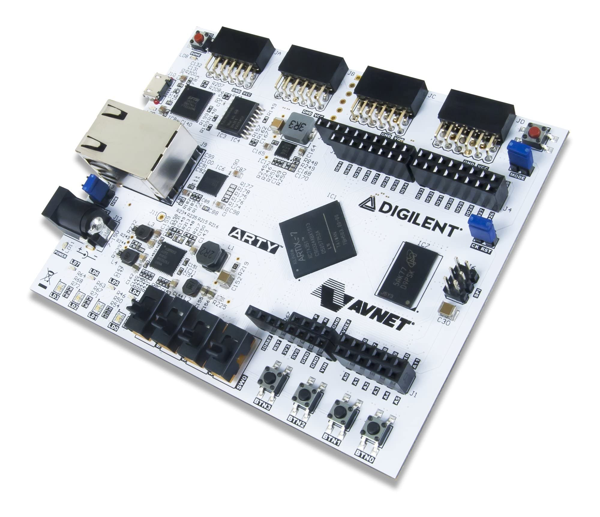
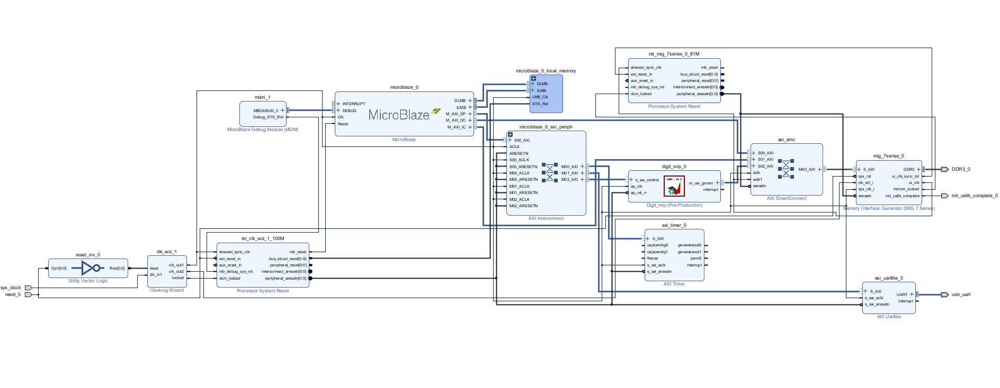

# FPGA Digit Classifier

An end-to-end handwritten-digit classifier implemented as a small quantized
neural network and accelerated on an AMD/Xilinx FPGA. The project covers model
training, integer quantization, Vitis HLS synthesis, Vivado integration, a
MicroBlaze firmware application, and Python image/camera clients.



> **Project status:** the repository contains generated Vivado/Vitis/HLS
> outputs and board-specific settings. The workflow below documents the
> current checked-in design; it is not intended to be a hardware-independent
> package yet.

## What it does

The accelerator classifies a single 28 × 28 grayscale image into one of the
ten decimal digits:

```text
784 uint8 pixels
        │
        ▼
32-neuron fully connected layer + ReLU + fixed-point rescaling
        │
        ▼
10-neuron fully connected layer
        │
        ▼
argmax → digit 0..9
```

The neural network is intentionally small:

| Layer | Shape | Representation |
| --- | ---: | --- |
| Input | 784 | unsigned 8-bit pixels |
| Hidden layer | 784 → 32 | signed 8-bit weights, 32-bit accumulators |
| Output layer | 32 → 10 | signed 8-bit weights, 32-bit accumulators |
| Output | 10 → 1 | integer class index |

The training notebook records `0.9608` float test accuracy and `0.9618` full
test-set accuracy after quantization with `SHIFT=12`. These are notebook
results, not a result re-run by this README.

## Hardware design

The design runs on a Digilent Arty A7-35 board. The Vivado block design
connects the MicroBlaze software system, external memory, UART, timer, and
the `digit_mlp` accelerator:



Measured on the current hardware build:

| Metric | Measurement |
| --- | ---: |
| FPGA inference time | **324 µs per image** |
| Complete host-to-host round trip | **77 ms per image** |

The FPGA measurement covers accelerator processing. The round-trip result
also includes image transfer over the 115200-baud UART and host-side overhead.

### Accelerator resource usage

The Vitis HLS synthesis report for `digit_mlp` provides the following
accelerator-level estimate for the target Artix-7 device
(`xc7a35ti-csg324-1L`):

| Resource | Used by `digit_mlp` | Available to HLS | Utilization |
| --- | ---: | ---: | ---: |
| BRAM18K | 35 | 100 | 35% |
| DSP | 18 | 90 | 20% |
| Flip-flop (FF) | 2,263 | 41,600 | 5% |
| LUT | 3,379 | 20,800 | 16% |
| URAM | 0 | 0 | 0% |

These figures come from
[`digit_mlp_csynth.rpt`](digitclassifier/solution1/syn/report/digit_mlp_csynth.rpt)
and describe the HLS IP estimate, not the complete Vivado system. The
MicroBlaze processor, DDR/MIG, UART, timer, interconnect, and other block
design components consume additional resources.

The routed Vivado block design report is available at
[`project_vivado/utilization_report.txt`](project_vivado/utilization_report.txt).
Its complete device-level totals are:

| Resource | Used | Available | Utilization |
| --- | ---: | ---: | ---: |
| Slice LUTs | 11,225 | 20,800 | 53.97% |
| Slice registers | 12,740 | 41,600 | 30.63% |
| Block RAM tiles | 25 | 50 | 50.00% |
| RAMB36/FIFO sites | 16 | 50 | 32.00% |
| RAMB18 sites | 18 | 100 | 18.00% |
| DSP48E1 sites | 33 | 90 | 36.67% |
| Slices | 4,177 | 8,150 | 51.25% |

The HLS and Vivado numbers must not be added together: the HLS table is an
estimate for the accelerator IP, while the Vivado table is the routed,
device-level result for the whole MicroBlaze system. The Vivado report uses
separate site categories for RAMB36 and RAMB18, so its BRAM figures are
reported exactly as generated rather than converted into a single BRAM count.

## Repository map

Only the source and reproducibility inputs are normally edited. Most other
directories are tool-generated products.

```text
modelTrain/
  tinyML_fpga.ipynb       Train the model and export weights/test data
  weights.h               Exported quantized parameters
  test_set.bin            1,000-image binary test set

digitclassifier/
  digit_mlp.cpp           HLS top function
  digit_mlp.h             HLS function declaration
  digit_mlp_tb.cpp        C simulation test bench
  weights.h               Parameters consumed by HLS
  test_set.bin            Test-bench input
  hls.app                 Vitis HLS project metadata
  solution1/              HLS directives, scripts, reports, and generated RTL

RTLexported/
  hdl/verilog/            Exported synthesizable Verilog
  drivers/                Packaged AXI-Lite driver
  constraints/            Out-of-context timing constraint

project_vivado/
  project_vivado.xpr      Vivado block-design project
  ...                     Generated IP, synthesis, implementation, and reports

digitClassifier_vitis/
  platform.tcl            Script for recreating the Vitis platform
  hw/                      XSA/bitstream and generated hardware drivers

digitClass/
  src/main.c              MicroBlaze firmware
  Debug/                   Built ELF and generated build files

test/
  test_fpga.py            Send one image over serial and print the result
  live_class.py           Camera-based live classifier
  test_camera.py          OpenCV camera discovery helper
```

## Hardware and toolchain

The checked-in project targets:

- **Board/platform:** Digilent Arty A7-35 (`xilinx:arty-a7-35`)
- **FPGA part:** `xc7a35ti-csg324-1L`
- **HLS/Vivado flow:** Vitis HLS 2023.1 and Vivado-generated IP
- **CPU:** MicroBlaze, standalone domain
- **Clock used by the HLS IP:** 10 ns (100 MHz)
- **Timer/UI clock assumed by the Python clients:** 81.25 MHz
- **UART baud rate:** 115200

Install the AMD/Xilinx tools and board files before attempting synthesis or
hardware execution. Python clients require Python 3 and:

```powershell
py -m pip install numpy opencv-python pyserial pillow
```

The notebook additionally uses TensorFlow, pandas, matplotlib, Kaggle, and
Google Colab helpers. It downloads EMNIST through Kaggle; do not commit a
`kaggle.json` credential.

## Reproduce the model export

Open [`modelTrain/tinyML_fpga.ipynb`](modelTrain/tinyML_fpga.ipynb) in Google
Colab or a compatible Jupyter environment and run the cells in order.

The export step:

1. Loads the EMNIST-derived 28 × 28 data.
2. Trains a `784 → 32 → 10` dense model.
3. Quantizes both weight matrices to signed `int8`.
4. Stores biases as `int32`.
5. Calibrates the hidden-layer right shift (`SHIFT=12` in the checked-in
   export).
6. Writes `weights.h`.
7. Writes `test_set.bin`.

The generated binary test set has this layout:

```text
1000 × 784 image bytes, followed by 1000 label bytes
```

The HLS test bench expects this exact layout and reads 785,000 bytes.

## Build the HLS IP

From a Vitis HLS command prompt, use the checked-in script:

```text
cd C:\HLS\digitclassifier
vitis_hls -f digitclassifier\solution1\script.tcl
```

The script creates/opens the `digitclassifier` HLS project, sets
`digit_mlp` as the top function, runs C simulation, synthesis, co-simulation,
and exports a Verilog IP catalog package to `RTLexported`.

For a quick software-only check, compile the top function and test bench with
any C++ compiler that accepts the HLS pragmas as ignored annotations. The
expected test-bench command is conceptually:

```text
digit_mlp_tb.exe
```

Run it with `test_set.bin` in the process working directory. A successful run
prints an accuracy line such as `acc 955/1000 = 95.50%`; the exact result
depends on the exported weights and test set.

## Build the Vivado/Vitis hardware design

1. Open `project_vivado\project_vivado.xpr` in Vivado.
2. Confirm that the `digit_mlp` IP is present in the IP repository and that the
   block design is validated.
3. Generate the bitstream and export the hardware platform/XSA.
4. Recreate or update the Vitis platform with:

   ```text
   xsct C:\HLS\digitclassifier\digitClassifier_vitis\platform.tcl
   ```

   `platform.tcl` contains an absolute hardware path. Change the
   `-hw`/`-out` paths when building on another machine.
5. Build the `digitClass` Vitis application for the generated standalone
   MicroBlaze domain.
6. Program the board with the generated bitstream and launch the ELF.

The firmware disables the data cache, receives 784 bytes, places the image in
external memory at `MIG base + 0x100000`, starts the `digit_mlp` AXI-Lite
control interface, waits for completion, and returns the digit and timer
count.

## Serial protocol

For every request, the host sends exactly **784 raw bytes** in row-major
28 × 28 order. The board returns exactly **5 bytes**:

```text
byte 0       predicted digit (0..9)
bytes 1..4   little-endian 32-bit cycle count
```

The host converts cycles to microseconds using `81.25 MHz`. The current
clients use `COM7` and **115200 baud** by default. Change `PORT` in
[`test/test_fpga.py`](test/test_fpga.py) and
[`test/live_class.py`](test/live_class.py) if Windows assigns a different
serial port.

## Run the Python clients

### Single image

```powershell
python test\test_fpga.py path\to\digit.png
```

The script crops the non-background content, normalizes it into a centered
28 × 28 image, saves the transmitted preview as `sent.png`, sends it to the
board, and prints the predicted digit, FPGA cycles, and round-trip time.

### Live camera

```powershell
python test\live_class.py
```

The live client captures a 300 × 300 center region, removes small connected
components, normalizes the largest digit into 28 × 28, and displays the FPGA
prediction. Press `i` to toggle dark-ink/light-background versus
light-ink/dark-background preprocessing, and `q` to quit.

Before using it:

- connect the board and identify its COM port;
- update `PORT` and `BAUD`;
- verify that the camera is available;
- ensure the camera image has enough contrast and only one digit in the box.

To enumerate camera backends:

```powershell
python test\test_camera.py
```

## Important implementation details

The HLS top function is [`digit_mlp`](digitclassifier/digit_mlp.cpp). It:

- exposes the image as an AXI master (`m_axi`) with depth 784;
- exposes control and return values through AXI-Lite;
- copies the image into a local buffer;
- pipelines the input copy and multiply-accumulate loops with `II=1`;
- applies ReLU and an arithmetic right shift;
- saturates hidden activations to 127;
- selects the output class with an integer argmax.

The generated RTL reports a synthesized latency of approximately 26,242
cycles in its `CORE_GENERATION_INFO`. Treat generated reports as
implementation evidence for the current tool run, not as a guaranteed timing
contract for every rebuilt design.

## Troubleshooting

| Symptom | Likely cause | Action |
| --- | --- | --- |
| `test_set.bin not found` | Wrong HLS simulation working directory | Put the binary beside the test executable or configure the test-bench data path |
| `timeout: no reply from FPGA` | Wrong COM port/baud, board not programmed, or firmware not running | Check the bitstream, ELF, UART connection, `PORT`, and `BAUD` |
| Predictions are consistently wrong | Preprocessing or quantization mismatch | Use the notebook export, preserve `SHIFT`, and send uint8 pixels in row-major order |
| Vivado cannot find the IP | IP repository is not configured | Add `RTLexported` as a Vivado IP repository and refresh the catalog |
| Platform recreation fails | `platform.tcl` contains paths from the original machine | Update its absolute `-hw` and `-out` paths |
| Camera opens but no digit is detected | Poor contrast, framing, or background | Adjust lighting, center one digit, and toggle preprocessing with `i` |

## Reproducibility and version-control guidance

The repository currently includes large generated directories such as
`solution1`, Vivado runs, Vitis BSPs, bitstreams, ELF files, and logs. They are
useful for reproducing the current board image but are not source-of-truth
inputs. For a maintainable GitHub repository, consider keeping:

- the notebook and its exported `weights.h`/`test_set.bin`;
- HLS C++ sources, directives, and Tcl scripts;
- Vivado block-design sources, constraints, and platform scripts;
- MicroBlaze application sources;
- Python clients and small test assets.

The root [`.gitignore`](.gitignore) excludes generated reports, caches,
temporary directories, hardware binaries, credentials, and machine-local
build products. It intentionally keeps source inputs, demo images, test
vectors, constraints, and the checked-in utilization reports.

## License and attribution

This project is released under the [MIT License](LICENSE).

The training notebook identifies the downloaded EMNIST dataset as CC0-1.0;
verify the dataset terms and all third-party tool licenses before
redistribution. The MIT license applies to this repository's original work,
not automatically to third-party datasets, tools, or generated vendor files.
